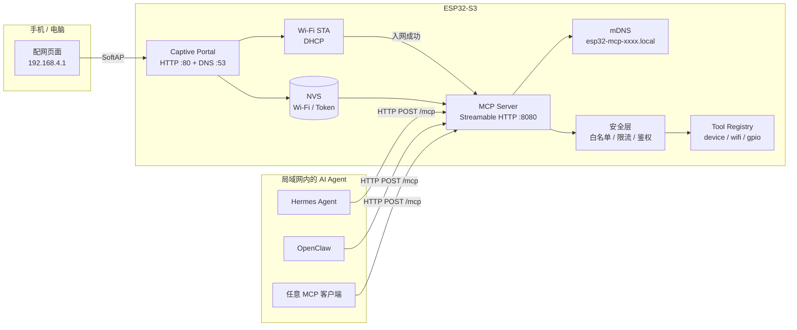
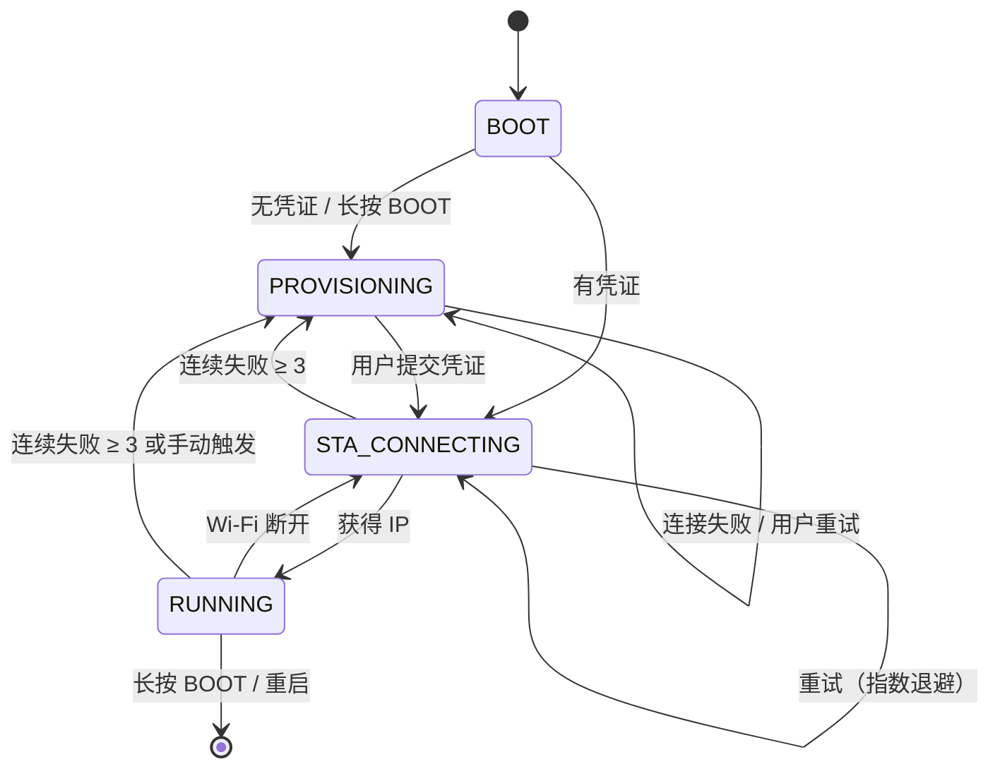
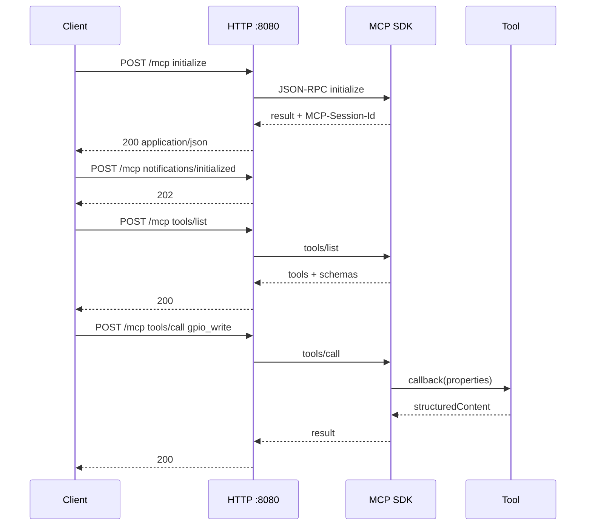
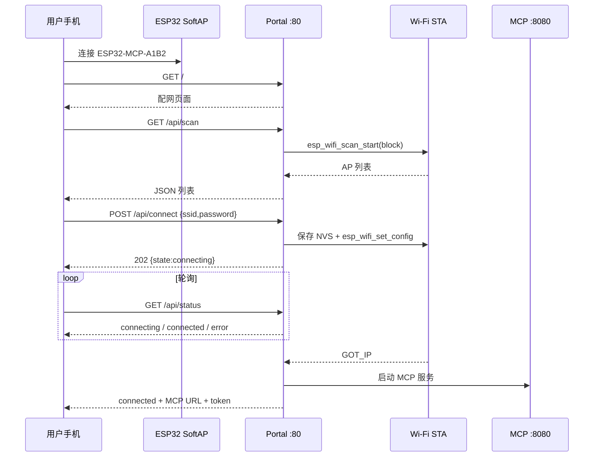

# ESP32-S3 MCP 节点详细设计

| 项目 | 内容 |
| --- | --- |
| 文档版本 | v0.2 |
| 日期 | 2026-10-23 |
| 目标硬件 | YD-ESP32-S3 N16R8（16 MB Flash / 8 MB OPI PSRAM，WS2812 在 GPIO48） |
| 软件基线 | ESP-IDF v6.1 + `espressif/mcp-c-sdk` v2.0.1 |
| 目标客户端 | Hermes Agent、OpenClaw，以及任意符合 MCP 2025-xx 的 Streamable HTTP 客户端 |
| 状态 | 设计已收敛，开始实现 |

---

## 1. 文档目的

本文档定义第一版 ESP32-S3 MCP 节点的完整设计，覆盖：

1. Wi-Fi 首次配网与局域网接入；
2. 基于 Streamable HTTP 的 MCP Server；
3. 面向 Hermes Agent / OpenClaw 的接入方式；
4. 局域网 OTA（网页上传 + Agent 触发）；
5. 安全边界、工程结构、测试方案与实施计划。

本文档描述第一版（MVP）范围。云端接入、BLE 配网、传感器扩展、Secure Boot 放在后续迭代。

---

## 2. 结论摘要

| 决策点 | 结论 |
| --- | --- |
| 开发框架 | ESP-IDF v6.1，不使用 Arduino/PlatformIO |
| MCP 协议栈 | 乐鑫官方 `espressif/mcp-c-sdk` v2.0.1，避免自研 JSON-RPC/MCP |
| MCP 传输 | Streamable HTTP，`POST http://<ip>:8080/mcp`，保留 GET SSE 能力 |
| 配网方式 | SoftAP + Captive Portal + 网页表单，凭证写入 NVS |
| 配网端口 | 配置门户 `80`，MCP 服务 `8080`，两个独立的 `httpd` 实例 |
| 服务发现 | mDNS：`esp32-mcp-xxxx.local:8080`，TXT 记录 `path=/mcp` |
| 认证 | `Authorization: Bearer <token>`；方案 B（已实现）：128 bit 随机令牌存入 NVS |
| 工具范围 | 设备信息/系统状态/Wi-Fi 状态/GPIO 读写/脉冲/WS2812/OTA |
| OTA | 双分区 + 回滚；局域网网页上传 + Agent URL 拉取；第一版不做 Secure Boot |
| GPIO 安全 | 默认引脚白名单 + 编译期只读开关 + 调用限流 |
| 客户端兼容 | Hermes 用 `url + headers`；OpenClaw 必须显式 `transport: "streamable-http"` |

> **实现说明**：`mcp-c-sdk` v2.0.1 的 HTTP Bearer Token 原本是编译期 Kconfig 常量。项目已内置该组件并加入弱符号钩子，从 NVS 读取每台设备独立的令牌（见 §8.3）。

---

## 3. 需求与验收标准

### 3.1 功能需求

| 编号 | 需求 |
| --- | --- |
| F1 | 设备首次启动且无 Wi-Fi 凭证时，自动开启配网热点和配置页面 |
| F2 | 用户可在手机/电脑上扫描周边 Wi-Fi、输入密码并完成入网 |
| F3 | 配网成功后设备自动连接路由器，凭据掉电保存 |
| F4 | 设备在局域网内提供 MCP Streamable HTTP 服务 |
| F5 | MCP 客户端可完成 `initialize`、`tools/list`、`tools/call` |
| F6 | 至少提供设备信息、系统状态、Wi-Fi 状态、GPIO 读写、GPIO 脉冲、LED 控制工具 |
| F7 | Hermes Agent 与 OpenClaw 均能发现并调用工具 |
| F8 | 支持通过 BOOT 键长按恢复出厂（清除 Wi-Fi 与令牌） |
| F9 | Wi-Fi 断线自动重连；连续失败进入配网回退模式 |
| F10 | MCP 接口支持 Bearer Token 认证（每台设备独立令牌） |
| F11 | 支持局域网网页上传固件并重启生效 |
| F12 | 支持 Agent 通过 URL + SHA256 + confirm 触发 OTA |
| F13 | 新固件健康检查失败时自动回滚旧分区 |
| F14 | 板载 WS2812 可通过 MCP 控制颜色和亮度 |

### 3.2 非功能需求

| 类别 | 指标 |
| --- | --- |
| 首次配网时间 | 上电到热点出现 ≤ 5 s；提交凭证到获得 IP ≤ 20 s |
| MCP 响应 | `tools/list` ≤ 200 ms；普通工具调用 ≤ 100 ms（不含网络） |
| 内存 | 稳定运行空闲堆 ≥ 100 KB（8 MB PSRAM 可选用于大缓冲） |
| 稳定性 | 7×24 h 运行；1000 次工具调用无泄漏、无崩溃 |
| OTA | 4 MB OTA 分区；升级失败/断电不影响当前固件；支持自动回滚 |
| 安全 | 默认需要 Bearer Token；禁止操作 Flash/PSRAM/Strapping 引脚 |
| 可维护性 | 工具实现按文件拆分，新增工具不改协议层代码 |

### 3.3 验收用例（摘要）

1. 擦除 NVS 后上电，5 s 内出现 `ESP32-MCP-xxxx` 热点。
2. 连接热点后自动弹出配置页；`/api/scan` 返回周边 AP。
3. 输入正确 SSID/密码，20 s 内获取 IP，串口打印 MCP URL 与令牌。
4. `curl` 完成 `initialize` → `tools/list` 返回 11 个工具。
5. 带 token 调用 `gpio_write` 可改变允许引脚电平；不带 token 返回 401。
6. 调用未授权引脚返回 `isError: true`，错误码 `pin_not_allowed`。
7. Hermes `hermes mcp test esp32_mcp` 通过，能调用 `device_info`。
8. OpenClaw `openclaw mcp probe esp32 --json` 通过，能调用 `gpio_read`。
9. 重启后自动入网，无需重新配网。
10. 输入错误密码后回到配网页面并显示错误原因。
11. 长按 BOOT 5 s 后重启进入配网模式，旧凭证被清除。
12. 网页上传新固件后重启，版本号变化且 Wi-Fi/Token 保留。
13. Agent 调用 `ota_apply` 从局域网 URL 升级成功。
14. 新固件启动后 30 s 内健康检查通过；人为崩溃时自动回滚。
15. `led_set` 可控制板载 WS2812 颜色/亮度。

---

## 4. 总体架构



### 4.1 运行时组件

| 组件 | 实现 | 说明 |
| --- | --- | --- |
| 网络栈 | `esp_netif` + `esp_wifi` + lwIP | STA/AP/APSTA |
| 事件循环 | `esp_event` | Wi-Fi、IP 事件驱动状态机 |
| 配置存储 | `nvs_flash` | Wi-Fi 凭证、MCP token、主机名 |
| 配网门户 | `esp_http_server` + 自定义 UDP DNS | 端口 80，仅配网模式启用 |
| MCP 协议 | `espressif/mcp-c-sdk` | 引擎 + HTTP server transport |
| MCP HTTP | `esp_http_server` | 端口 8080，独立实例 |
| 服务发现 | `mdns` | `_http._tcp`，TXT `path=/mcp` |
| GPIO | `driver/gpio` + `esp_timer` | 读写与脉冲 |
| 日志 | `esp_log` | 串口 + 可选 MCP logging |

### 4.2 端口分配

| 端口 | 用途 | 暴露范围 |
| --- | --- | --- |
| 80/TCP | 配网页、状态页、配网 API | 配网 AP 内；STA 模式默认只开状态页 |
| 53/UDP | Captive Portal DNS | 仅配网 AP |
| 8080/TCP | MCP Streamable HTTP | 局域网 STA |
| 5353/UDP | mDNS | 局域网 STA |

> 不使用 80 作为 MCP 端口，避免与配网门户冲突；端口可通过 Kconfig 修改。

---

## 5. 启动流程与状态机

### 5.1 启动顺序

```text
上电
  ├─ NVS 初始化（失败则 erase + reboot）
  ├─ 读取配置：wifi_ssid / wifi_pass / mcp_token / hostname
  ├─ 检查 BOOT 键是否长按 → 是则清除配置并重启
  ├─ esp_netif / esp_event / esp_wifi 初始化
  ├─ 有凭证？
  │    ├─ 是 → STA 连接（超时 20 s）
  │    │        ├─ 成功 → RUNNING
  │    │        └─ 失败 → 重试，3 次失败后进入 PROVISIONING（APSTA）
  │    └─ 否 → PROVISIONING
  └─ PROVISIONING / RUNNING 状态循环
```

### 5.2 状态机



### 5.3 状态定义

| 状态 | AP | STA | MCP | 门户 |
| --- | --- | --- | --- | --- |
| `BOOT` | 关 | 关 | 停 | 停 |
| `PROVISIONING` | 开 | 扫描/尝试连接 | 默认停（可配置开） | 开 |
| `STA_CONNECTING` | 关（或 APSTA） | 连接中 | 停 | 关 |
| `RUNNING` | 关（连接成功后 120 s 关闭） | 已连接 | 开 | 状态页 |
| `ERROR` | 开 | 失败 | 停 | 开（显示错误） |

> 回退策略：连续 3 次 STA 失败后启动 APSTA，AP 与 STA 重试并存；用户在门户中可重新输入凭证。STA 成功后关闭 AP。

---

## 6. Wi-Fi 配网详细设计

### 6.1 首次启动

- NVS 中不存在 `wifi/ssid` 或 `wifi/configured != 1` 时进入配网。
- 生成 AP SSID：`<prefix>-<MAC 后 4 位十六进制>`，例如 `ESP32-MCP-A1B2`。
- AP 密码：Kconfig 默认 `esp32mcp`（WPA2-PSK，至少 8 位），允许构建时覆盖。
- AP IP：`192.168.4.1/24`，DHCP Server 分配 `192.168.4.2 ~ 192.168.4.10`。
- 启动 Captive DNS（UDP 53），对所有 A 记录查询返回 `192.168.4.1`。
- 启动配置门户（HTTP 80）。

### 6.2 配网页面

页面为单文件 HTML（`main/web/index.html`），通过 `EMBED_TXTFILES` 编译进固件，避免文件系统依赖。

页面功能：

1. 展示设备名称、固件版本、当前状态；
2. 点击“扫描 Wi-Fi”，调用 `GET /api/scan`，以列表展示 SSID、RSSI、加密方式；
3. 选择 SSID，输入密码（支持显示/隐藏）；
4. 提交 `POST /api/connect`，轮询 `GET /api/status`；
5. 成功后在页面展示 MCP URL 与令牌（仅本次展示，可复制）；
6. 失败时展示错误码与重试按钮。

页面不做前端框架，原生 HTML/CSS/JS，体积控制在 20 KB 内。

### 6.3 配网 API

| 方法 | 路径 | 说明 |
| --- | --- | --- |
| GET | `/` | 配网首页 |
| GET | `/api/scan` | 扫描周边 AP |
| POST | `/api/connect` | 提交 SSID/密码并触发连接 |
| GET | `/api/status` | 查询当前状态、IP、错误码 |
| POST | `/api/forget` | 清除凭证并重启到配网模式 |
| POST | `/api/reboot` | 重启设备 |
| GET | `/generate_204` | Android Captive Portal 探测 → 302 |
| GET | `/hotspot-detect.html` | Apple Captive Portal 探测 → 302 |
| GET | `/connecttest.txt` | Windows 探测 → 302 |
| GET | `/ncsi.txt` | Windows NCSI 探测 → 302 |

#### `GET /api/scan` 响应

```json
{
  "networks": [
    { "ssid": "HomeWiFi", "rssi": -48, "auth": 3, "channel": 6 },
    { "ssid": "Office-5G", "rssi": -71, "auth": 4, "channel": 149 }
  ]
}
```

规则：

- 隐藏 SSID 不返回；
- 相同 SSID 只保留信号最强的一条；
- 最多返回 20 条，按 RSSI 降序；
- 扫描在 HTTP handler 中同步执行（`block=true`），单次约 1.5~2 s；
- 扫描期间设备保持 AP 可用（APSTA）。

#### `POST /api/connect` 请求

```json
{ "ssid": "HomeWiFi", "password": "********" }
```

校验：

- `ssid` 长度 1~32 字节；
- `password` 长度 0~64 字节（开放网络允许空）；
- 拒绝包含控制字符的输入；
- 同一时间只允许一个连接任务；
- 先保存到 NVS（标记 `pending=1`），连接成功后再置 `configured=1`。

响应：

```json
{ "accepted": true, "state": "connecting" }
```

连接结果通过 `/api/status` 轮询：

```json
{
  "state": "connecting",
  "ssid": "HomeWiFi",
  "ip": "",
  "error": null,
  "mcp_url": "",
  "fw_version": "0.1.0"
}
```

成功：

```json
{
  "state": "connected",
  "ssid": "HomeWiFi",
  "ip": "192.168.3.50",
  "error": null,
  "mcp_url": "http://192.168.3.50:8080/mcp",
  "fw_version": "0.1.0"
}
```

失败：

```json
{
  "state": "error",
  "ssid": "HomeWiFi",
  "ip": "",
  "error": "auth_failed",
  "mcp_url": "",
  "fw_version": "0.1.0"
}
```

错误码：`auth_failed`、`ap_not_found`、`timeout`、`invalid_args`、`internal`。

### 6.4 Captive Portal DNS

- 监听 UDP 53；
- 解析 DNS 问题段，复制 Transaction ID、Flags（QR=1, AA=1, RA=1）；
- 对任意 A 查询返回 `192.168.4.1`，TTL 60；
- 对 AAAA 查询返回空答案（NOERROR）；
- 其他类型返回 NOTIMP；
- 仅配网模式启动，退出配网时停止任务并关闭 socket。

### 6.5 NVS 数据结构

| Namespace | Key | 类型 | 说明 |
| --- | --- | --- | --- |
| `app_cfg` | `version` | u8 | 配置版本，当前 1 |
| `app_cfg` | `wifi_ssid` | string | STA SSID |
| `app_cfg` | `wifi_pass` | string | STA 密码 |
| `app_cfg` | `wifi_configured` | u8 | 0/1，是否已完成过一次成功连接 |
| `app_cfg` | `wifi_pending` | u8 | 0/1，凭证已保存但尚未验证成功 |
| `app_cfg` | `mcp_token` | string | 方案 B：32 字符十六进制令牌；方案 A 不使用该键 |
| `app_cfg` | `hostname` | string | `esp32-mcp-xxxx` |
| `app_cfg` | `ap_pass` | string | 预留：每台设备独立 AP 密码 |

注意：

- NVS 默认不加密；第一版接受该风险。
- 第二阶段可启用 NVS Encryption + Flash Encryption（需额外分区与量产流程）。
- 任何日志不得打印 Wi-Fi 密码或完整 MCP token（最多打印后 4 位）。

### 6.6 配网失败与恢复

| 场景 | 处理 |
| --- | --- |
| SSID 不存在 | 30 s 超时，返回 `ap_not_found`，保留 AP |
| 密码错误 | 捕获 `WIFI_EVENT_STA_DISCONNECTED` 原因码，返回 `auth_failed` |
| DHCP 超时 | 20 s 超时，返回 `timeout` |
| 连接中断 | `RUNNING` 下指数退避重连（1/2/4/8/16/30 s，上限 30 s） |
| 连续 3 次失败 | 启动 APSTA 回退，门户可用 |
| 持续失败 | 每 30 s 重试一次，保持 AP 可用；用户可随时重新提交凭证 |
| BOOT 长按 5 s | 清除 `app_cfg` 下所有键，重启进入配网 |
| 门户长时间无操作 | 第一版不自动关闭；AP 使用 WPA2，建议配网完成后尽快连接 |

### 6.7 STA 连接参数

- 主机名：`esp32-mcp-xxxx`（`esp_netif_set_hostname`）；
- DHCP 客户端默认开启；
- `esp_wifi_set_ps(WIFI_PS_MIN_MODEM)` 降低功耗，同时保持可接受的 MCP 延迟；
- 国家码按 `CONFIG_ESP_WIFI_COUNTRY`，默认 `CN`；
- 不启用企业级 WPA2-Enterprise（第一版）；
- 不支持 5 GHz（ESP32-S3 仅 2.4 GHz），配网页面需提示。

---

## 7. MCP 服务设计

### 7.1 为什么使用 `mcp-c-sdk`

| 方案 | 优点 | 缺点 |
| --- | --- | --- |
| 自研 JSON-RPC + HTTP | 完全可控 | 工作量大，协议版本/会话/SSE/分页易出错 |
| 第三方 Arduino MCP 库 | 上手快 | 生态碎片化，维护不稳定 |
| **`espressif/mcp-c-sdk` v2.0.1** | 官方维护、支持 Streamable HTTP、tools/resources/prompts/tasks、协议版本 2024-11-05 ~ 2025-11-25 | 部分能力仍标注为增量支持；Bearer token 为编译期常量 |

结论：使用官方 SDK，应用层只负责 Wi-Fi、工具实现与安全封装。

### 7.2 传输与端点

- 传输：`esp_mcp_transport_http_server`（内置）。
- 端点名：`mcp` → URL 路径 `/mcp`。
- 端口：`8080`。
- 同时注册 `/mcp_sse`（SDK 自动），用于 Streamable HTTP 的 GET SSE 流。
- 客户端必须使用 `POST /mcp`，`Content-Type: application/json`。
- 推荐客户端发送：
  ```http
  Accept: application/json, text/event-stream
  ```
- 成功响应为 `application/json`；无响应体时为 `202 Accepted`。
- 会话通过响应头 `MCP-Session-Id` 建立；后续请求带回该头。
- 会话空闲超时：默认 10 分钟，本项目设为 **60 分钟**（`CONFIG_MCP_HTTP_SESSION_TTL_MS=3600000`），减少 Agent 重连。
- SSE 心跳：15 s；最大客户端数：2。
- CORS：关闭（非浏览器客户端）。
- OAuth metadata：关闭，避免向客户端广告虚假的 OAuth 端点。
- 协议版本支持：`2024-11-05`、`2025-03-26`、`2025-06-18`、`2025-11-25`，由 SDK 协商。

### 7.3 MCP 初始化顺序

```c
esp_mcp_t *mcp = NULL;
ESP_ERROR_CHECK(esp_mcp_create(&mcp));
ESP_ERROR_CHECK(esp_mcp_set_server_info(
    mcp,
    "ESP32-S3 MCP Node",
    "Wi-Fi connected ESP32-S3 device exposing GPIO and status tools.",
    NULL,
    NULL));
ESP_ERROR_CHECK(esp_mcp_set_instructions(
    mcp,
    "This device controls only the GPIO pins listed by gpio_list. "
    "Prefer read-only tools first. GPIO writes are physically actuating; "
    "use gpio_pulse for momentary signals."));

register_device_tools(mcp);
register_gpio_tools(mcp);
register_resources(mcp);

httpd_config_t http_cfg = HTTPD_DEFAULT_CONFIG();
http_cfg.server_port = CONFIG_APP_MCP_PORT;
http_cfg.max_open_sockets = 6;
http_cfg.max_uri_handlers = 8;
http_cfg.stack_size = 8192;
http_cfg.lru_purge_enable = true;

esp_mcp_mgr_config_t mgr_cfg = {
    .transport = esp_mcp_transport_http_server,
    .config = &http_cfg,
    .instance = mcp,
};
esp_mcp_mgr_handle_t mgr = 0;
ESP_ERROR_CHECK(esp_mcp_mgr_init(mgr_cfg, &mgr));
ESP_ERROR_CHECK(esp_mcp_mgr_start(mgr));
ESP_ERROR_CHECK(esp_mcp_mgr_register_endpoint(mgr, "mcp", mcp));
```

> 注意：`mcp-c-sdk` 的 README 示例中出现的 `MCP_SERVER_DEFAULT_CONFIG()` 在 v2.0.1 头文件中并不存在，实际配置类型是 `httpd_config_t`；并且必须显式调用 `esp_mcp_mgr_register_endpoint()`，否则 `/mcp` 不会注册成功。由于内置 HTTP transport 在 `esp_mcp_mgr_start()` 里才创建 `httpd` 实例，注册端点的正确顺序是 **init → start → register_endpoint**。

### 7.4 工具清单

工具名统一使用 `snake_case`，只包含 `[a-z0-9_]`，避免客户端把工具名映射为函数名时出错。

| 工具 | 读/写 | 功能 | 关键参数 |
| --- | --- | --- | --- |
| `device_info` | 只读 | 芯片、MAC、固件、SDK、Flash、运行时间 | 无 |
| `sys_status` | 只读 | 堆内存、任务数、CPU 频率、复位原因 | 无 |
| `wifi_status` | 只读 | SSID、IP、RSSI、信道、mDNS 名 | 无 |
| `gpio_list` | 只读 | 返回允许操作的引脚及当前电平 | 无 |
| `gpio_read` | 只读 | 读取指定引脚电平 | `pin` |
| `gpio_write` | 写 | 设置引脚电平 | `pin`, `level`（high/low）, `hold_ms?` |
| `gpio_pulse` | 写 | 输出指定宽度的脉冲后自动恢复 | `pin`, `active_level?`（high/low）, `duration_ms` |
| `led_set` | 写 | 控制板载 WS2812 颜色/亮度 | `on`, `color?`, `brightness?` |
| `ota_status` | 只读 | OTA 状态、分区、版本、进度 | 无 |
| `ota_apply` | 写/危险 | 从局域网 URL 下载并升级 | `url`, `sha256`, `version`, `confirm` |
| `ota_abort` | 写 | 取消正在进行的 OTA | 无 |

第一版共 **11 个工具**。`led_set` 控制 YD-ESP32-S3 板载 WS2812（GPIO48，RMT 驱动）。

#### 7.4.1 `device_info`

输入 schema：

```json
{ "type": "object", "properties": {}, "additionalProperties": false }
```

返回（`structuredContent`）：

```json
{
  "model": "ESP32-S3",
  "chip_revision": "v0.2",
  "mac": "AA:BB:CC:DD:EE:FF",
  "firmware": "0.1.0",
  "idf": "v6.1",
  "mcp_sdk": "2.0.1",
  "uptime_s": 1234,
  "reset_reason": "POWERON",
  "flash_size_kb": 8192,
  "free_heap_kb": 182
}
```

#### 7.4.2 `sys_status`

返回：

```json
{
  "uptime_s": 1234,
  "free_heap_kb": 182,
  "min_free_heap_kb": 151,
  "largest_free_block_kb": 96,
  "task_count": 14,
  "cpu_freq_mhz": 240,
  "reset_reason": "POWERON"
}
```

#### 7.4.3 `wifi_status`

返回：

```json
{
  "connected": true,
  "ssid": "HomeWiFi",
  "bssid": "11:22:33:44:55:66",
  "ip": "192.168.3.50",
  "netmask": "255.255.255.0",
  "gateway": "192.168.3.1",
  "rssi": -48,
  "channel": 6,
  "auth_mode": "WPA2_PSK",
  "hostname": "esp32-mcp-a1b2",
  "mdns": "esp32-mcp-a1b2.local"
}
```

#### 7.4.4 `gpio_list`

返回：

```json
{
  "writable": true,
  "pins": [
    { "pin": 4, "level": 0, "mode": "output" },
    { "pin": 5, "level": 1, "mode": "input" }
  ]
}
```

#### 7.4.5 `gpio_read`

输入：

```json
{
  "type": "object",
  "properties": {
    "pin": { "type": "integer", "minimum": 0, "maximum": 48 }
  },
  "required": ["pin"],
  "additionalProperties": false
}
```

成功：

```json
{ "pin": 4, "level": 1, "mode": "input", "allowed": true }
```

失败（`isError: true`）：

```json
{ "error": "pin_not_allowed", "message": "GPIO 19 is reserved for USB" }
```

#### 7.4.6 `gpio_write`

输入：

```json
{
  "type": "object",
  "properties": {
    "pin":   { "type": "integer", "minimum": 0, "maximum": 48 },
    "level": { "type": "string", "enum": ["high", "low"] },
    "hold_ms": { "type": "integer", "minimum": 0, "maximum": 60000, "default": 0 }
  },
  "required": ["pin", "level"],
  "additionalProperties": false
}
```

行为：

- 校验引脚在白名单内且支持输出；
- 设置 `gpio_set_level`；
- 若 `hold_ms > 0`，启动一次性定时器，到期后恢复为写入前的电平；
- 返回 `{ "pin": 4, "level": 1, "revert_in_ms": 500 }`。

#### 7.4.7 `gpio_pulse`

输入：

```json
{
  "type": "object",
  "properties": {
    "pin": { "type": "integer", "minimum": 0, "maximum": 48 },
    "active_level": { "type": "string", "enum": ["high", "low"], "default": "high" },
    "duration_ms": { "type": "integer", "minimum": 10, "maximum": 5000 }
  },
  "required": ["pin", "duration_ms"],
  "additionalProperties": false
}
```

行为：非阻塞，拉高/拉低后由 `esp_timer` 在 `duration_ms` 后恢复；重复调用同一引脚时先取消旧定时器。

#### 7.4.8 `led_set`

输入：

```json
{
  "type": "object",
  "properties": {
    "on": { "type": "boolean", "default": true },
    "color": { "type": "string", "description": "#RRGGBB, default #0000FF" },
    "brightness": { "type": "integer", "minimum": 0, "maximum": 100, "default": 20 }
  },
  "additionalProperties": false
}
```

`led_set` 使用 `espressif/led_strip` 驱动 GPIO48 上的 WS2812；`on=false` 时关闭，`brightness` 按比例缩放 RGB，颜色解析失败返回 `invalid_args`。

### 7.5 工具注解

通过 `esp_mcp_tool_set_annotations_json()` 设置，便于 OpenClaw/Codex 的审批策略使用：

| 工具 | annotations |
| --- | --- |
| `device_info`, `sys_status`, `wifi_status`, `gpio_list`, `gpio_read` | `{"readOnlyHint":true,"idempotentHint":true,"openWorldHint":false}` |
| `gpio_write` | `{"readOnlyHint":false,"destructiveHint":true,"idempotentHint":true,"openWorldHint":false}` |
| `gpio_pulse` | `{"readOnlyHint":false,"destructiveHint":true,"idempotentHint":false,"openWorldHint":false}` |
| `led_set` | `{"readOnlyHint":false,"destructiveHint":false,"idempotentHint":true,"openWorldHint":false}` |
| `ota_status` | `{"readOnlyHint":true,"idempotentHint":true,"openWorldHint":false}` |
| `ota_apply` | `{"readOnlyHint":false,"destructiveHint":true,"idempotentHint":false,"openWorldHint":true}` |
| `ota_abort` | `{"readOnlyHint":false,"destructiveHint":false,"idempotentHint":true,"openWorldHint":false}` |

### 7.6 Resources

第一版提供两个只读资源，便于 Hermes/OpenClaw 的 resources 工具读取：

| URI | MIME | 内容 |
| --- | --- | --- |
| `device://info` | `application/json` | 同 `device_info` 的结构化信息 |
| `device://gpio` | `application/json` | 白名单引脚及当前电平快照 |

不暴露 `device://wifi`，避免把 SSID/BSSID 作为资源长期缓存。Wi-Fi 信息通过工具按需读取。

资源回调在 `esp_mcp_resource_read_cb_t` 中动态生成 JSON，使用 `strdup` 分配，框架负责 `free`。返回内容控制在 1 KB 内。

### 7.7 错误模型

工具级失败不使用 JSON-RPC error，而使用 MCP `CallToolResult.isError = true`，并返回结构化文本：

```json
{
  "error": "pin_not_allowed",
  "message": "GPIO 19 is reserved for USB"
}
```

| 错误码 | 场景 |
| --- | --- |
| `invalid_args` | 参数缺失、类型错误、越界 |
| `pin_not_allowed` | 引脚不在白名单或为保留引脚 |
| `pin_not_output_capable` | 对输入专用引脚执行写操作 |
| `led_not_configured` | 未配置 LED 引脚 |
| `busy` | 同一引脚正在执行脉冲/保持操作 |
| `rate_limited` | 超过调用频率 |
| `internal` | GPIO 驱动或内存错误 |

协议级错误（未知方法、无效 JSON-RPC、未知工具）由 SDK 返回标准 JSON-RPC error，应用层不重复处理。

### 7.8 并发、超时与限流

- SDK 工具回调运行在独立的 toolcall 任务（`CONFIG_MCP_TOOLCALL_STACK_SIZE=8192`）。
- 所有 GPIO 操作使用互斥锁保护，避免两个 Agent 同时操作同一引脚。
- 每个引脚维护 `pulse_timer`，重复调用先取消旧定时器。
- 全局令牌桶：10 次/秒，突发 20 次；超限返回 `rate_limited`，并记录日志。
- 工具回调禁止阻塞超过 50 ms；`gpio_pulse` 使用定时器，不 `vTaskDelay`。
- SSE 最大 2 个客户端；HTTP 最大 6 个 socket；开启 `lru_purge_enable`。
- `tools/list` JSON 控制在 8 KB 内；必要时把描述写短，或调大 `CONFIG_MCP_TOOLLIST_MAX_SIZE`。

### 7.9 MCP 生命周期



- 客户端不发送 `MCP-Session-Id` 时，SDK 会生成新会话（便于 curl 调试）。
- 会话过期返回 404；客户端应重新 `initialize`。OpenClaw 会自动重建连接，Hermes 在 `/reload-mcp` 后恢复。
- 服务端通知（如资源变更、日志）通过 `esp_mcp_mgr_emit_message()` 发送到 SSE；第一版不主动推送。

---

## 8. 安全设计

### 8.1 威胁模型

| 威胁 | 影响 | 缓解 |
| --- | --- | --- |
| 同一局域网内的未授权 MCP 调用 | 控制 GPIO | 强制 Bearer Token；默认关闭无认证模式 |
| 恶意 Agent 误操作继电器 | 物理设备动作 | 引脚白名单、工具注解、限流、`gpio_pulse` 优先 |
| 配网热点被他人接入 | 篡改 Wi-Fi 配置 | WPA2 热点、配网窗口有限、成功后关闭 AP |
| 串口日志泄露 token | 凭据泄露 | 日志脱敏；仅配网成功页展示一次 |
| 固件被替换 | 完全控制 | 第二阶段启用 Secure Boot + Flash Encryption + 签名 OTA |
| NVS 被读取 | Wi-Fi/token 泄露 | 第二阶段启用 NVS Encryption |
| 公网暴露 | 远程攻击 | 仅监听局域网；不建议端口映射；文档明确警告 |

### 8.2 网络暴露面

- MCP 只绑定 STA 接口（`0.0.0.0:8080`，但仅 STA 有路由）。
- 配网门户只在 AP 模式监听 80；STA 模式下如需状态页，仅提供只读信息。
- 不启用 UPnP、不做 NAT 穿透、不接入云。
- mDNS 仅局域网可见。

### 8.3 MCP Bearer Token 方案

`mcp-c-sdk` v2.0.1 的认证逻辑在 `esp_mcp_http_server.c` 中直接比较：

```c
strcmp(token, CONFIG_MCP_HTTP_AUTH_BEARER_TOKEN) == 0
```

因此默认只能使用编译期固定 token。推荐三种方案：

| 方案 | 做法 | 优点 | 缺点 |
| --- | --- | --- | --- |
| A. MVP | `CONFIG_MCP_HTTP_AUTH_ENABLE=y`，token 写在 `sdkconfig.defaults` | 零改动、1 小时完成 | 所有设备共用同一 token；token 进入固件 |
| **B. 推荐（已采用）** | 将组件放入 `components/mcp-c-sdk`，增加弱符号钩子，从 NVS 读取 token | 每台设备独立 token；可 upstream | 需要维护 5~10 行补丁 |
| C. 无认证 | 仅在可信 VLAN 使用 | 最简单 | 不推荐；任何设备可操作 GPIO |

方案 B 的补丁示意：

```c
/* components/mcp-c-sdk/src/transports/esp_mcp_http_server.c */
__attribute__((weak)) const char *esp_mcp_http_get_bearer_token(void)
{
    return CONFIG_MCP_HTTP_AUTH_BEARER_TOKEN;
}

/* 原来比较 CONFIG_MCP_HTTP_AUTH_BEARER_TOKEN 的位置改为 */
const char *expected = esp_mcp_http_get_bearer_token();
if (expected && expected[0] && esp_mcp_ct_streq(token, expected)) { ... }
```

应用侧实现：

```c
const char *esp_mcp_http_get_bearer_token(void)
{
    static char token[33];
    if (!nvs_load_string("app_cfg", "mcp_token", token, sizeof(token))) {
        return NULL;
    }
    return token;
}
```

> 已采用方案 B：组件内置在 `components/mcp-c-sdk`，应用侧实现 `esp_mcp_http_get_bearer_token()` 返回 NVS 令牌。

### 8.4 令牌生成与展示（方案 B）

> 方案 A 跳过令牌生成，直接使用 `CONFIG_MCP_HTTP_AUTH_BEARER_TOKEN`；此时配网页展示的是固件级共享令牌，恢复出厂不会改变它。

- 首次启动（或恢复出厂后）用 `esp_random()` 生成 16 字节，转 32 字符小写十六进制。
- 写入 NVS `app_cfg/mcp_token`。
- 串口启动日志打印：
  ```
  I (1234) app: MCP endpoint: http://192.168.3.50:8080/mcp
  I (1235) app: MCP token (last 4): ****c3f2
  ```
- 配网成功页展示完整 token 一次，并提供“复制”按钮；刷新后只显示后 4 位。
- 恢复出厂会重新生成 token，旧客户端配置需更新。

### 8.5 GPIO 白名单

默认白名单（YD-ESP32-S3 N16R8）：

```text
4, 5, 6, 7, 8, 15, 16, 17, 18, 21, 38
```

默认排除：

| 引脚 | 原因 |
| --- | --- |
| 0 | BOOT / Strapping |
| 3, 45, 46 | Strapping / 启动模式 |
| 19, 20 | USB D-/D+ |
| 26~37 | SPI Flash / Octal PSRAM（N16R8 的 35/36/37 被 PSRAM 占用） |
| 43, 44 | UART0 TX/RX |
| 48 | 板载 WS2812，由 `led_set` 专用 |
| 47 | 八线 SPI 相关，保守排除 |

实现：

- 启动时解析 `CONFIG_APP_GPIO_ALLOWLIST` 为位图；
- `gpio_list` 只返回白名单引脚；
- 写操作要求 `CONFIG_APP_GPIO_ALLOW_WRITE=y`，默认开启；
- 若引脚在白名单但硬件不支持输出，返回 `pin_not_output_capable`；
- 生产固件建议把白名单缩小到实际使用的 2~4 个引脚。

### 8.6 其他加固

- 配网 API 只接受 `Content-Type: application/json`，拒绝表单跨站提交；
- 门户页面不加载外部 CDN 资源，避免离线失败与供应链风险；
- 关闭 CORS；
- 关闭 OAuth metadata；
- 限制 HTTP body 大小（门户 2 KB，MCP 由 SDK 限制 1 MB，可后续收紧）；
- 工具调用日志记录：时间、工具名、引脚、结果、客户端会话 ID 后 4 位；不记录 token；
- 可选：`CONFIG_APP_MCP_ALLOWED_CLIENTS` 按 IP 白名单（第二版）。

---

## 9. 客户端接入

### 9.1 前置条件

1. ESP32 与运行 Agent 的机器在同一局域网；
2. 已通过配网页面获得 IP 与 token；
3. 确认连通性：

```bash
curl -s -X POST http://192.168.3.50:8080/mcp \
  -H 'Content-Type: application/json' \
  -H 'Accept: application/json, text/event-stream' \
  -H 'Authorization: Bearer <token>' \
  -d '{"jsonrpc":"2.0","id":1,"method":"initialize","params":{"protocolVersion":"2025-06-18","capabilities":{},"clientInfo":{"name":"curl","version":"0"}}}'
```

预期返回 `result.serverInfo`、`result.capabilities` 和响应头 `MCP-Session-Id`。

### 9.2 Hermes Agent

Hermes 的 MCP 配置使用 `url` + `headers`，支持 Streamable HTTP。示例（`~/.hermes/config.yaml`）：

```yaml
mcp_servers:
  esp32_mcp:
    url: "http://192.168.3.50:8080/mcp"
    headers:
      Authorization: "Bearer <token>"
    tools:
      include:
        - device_info
        - sys_status
        - wifi_status
        - gpio_list
        - gpio_read
        - gpio_write
        - gpio_pulse
        - led_set
      prompts: false
      resources: true
```

验证：

```bash
hermes mcp test esp32_mcp
```

成功后在 Hermes 中执行：

```text
调用 esp32_mcp 的 device_info，然后读取 GPIO 4 的电平。
```

注意：

- 首次连接后如修改配置，执行 `/reload-mcp`；
- 建议先用 `tools.include` 只开放只读工具，确认无误后再加入 `gpio_write`；
- Hermes 会把工具名加前缀，实际名称可能是 `mcp_esp32_mcp_device_info`，以 `tools/list` 为准。

### 9.3 OpenClaw

OpenClaw 保存的 MCP 定义默认使用 SSE；**必须显式指定 `transport: "streamable-http"`**，否则会按旧 SSE 传输连接并失败。

```bash
openclaw mcp set esp32_mcp '{
  "url": "http://192.168.3.50:8080/mcp",
  "transport": "streamable-http",
  "headers": {"Authorization": "Bearer <token>"},
  "connectionTimeoutMs": 5000,
  "requestTimeoutMs": 10000
}'
```

> `openclaw mcp set/add/configure` 等写操作要求本地 Gateway 已停止；只读的 `list/show/status` 不受影响。使用 Control UI 的 `/settings/mcp` 也可以编辑。

验证：

```bash
openclaw mcp probe esp32_mcp --json
openclaw mcp doctor esp32_mcp --probe
```

限制工具范围（推荐）：

```bash
openclaw mcp configure esp32_mcp \
  --include 'device_info,sys_status,wifi_status,gpio_list,gpio_read'
```

确认只读无误后，再按需加入：

```bash
openclaw mcp configure esp32_mcp \
  --include 'device_info,sys_status,wifi_status,gpio_list,gpio_read,gpio_write,gpio_pulse'
```

注意：

- OpenClaw 的 `mcp probe` 会实际建立 MCP 会话并列出工具；
- 如果 token 错误，probe 会报告认证失败；
- 建议设置 `requestTimeoutMs` ≥ 10000，覆盖 `gpio_pulse` 的最大 5 s。

### 9.4 通用 Python 客户端

```python
import asyncio
from mcp import ClientSession
from mcp.client.streamable_http import streamablehttp_client

URL = "http://192.168.3.50:8080/mcp"
TOKEN = "<token>"

async def main():
    headers = {"Authorization": f"Bearer {TOKEN}"}
    async with streamablehttp_client(URL, headers=headers) as (read, write, _):
        async with ClientSession(read, write) as session:
            await session.initialize()
            tools = await session.list_tools()
            print([t.name for t in tools.tools])
            result = await session.call_tool("device_info", {})
            print(result.content)

asyncio.run(main())
```

该脚本放入 `tools/test_mcp.py`，作为端到端冒烟测试。

### 9.5 mDNS

设备启动后广播：

```text
_http._tcp.local
  instance: ESP32-S3 MCP Node
  host: esp32-mcp-a1b2.local
  port: 8080
  txt: path=/mcp, mcp=1, version=0.1.0, model=ESP32-S3
```

使用方式：

```bash
curl http://esp32-mcp-a1b2.local:8080/mcp ...
```

注意：

- Windows 默认可能不解析 `.local`，需安装 Bonjour 或直接使用 IP；
- Hermes/OpenClaw 不保证自动发现 mDNS，仍需手动填写 URL；
- 主机名冲突时用 MAC 后 4 位区分。

---

## 10. 工程结构

```text
esp32_mcp/
├── CMakeLists.txt                 # 顶层工程
├── sdkconfig.defaults             # 默认配置
├── partitions.csv                 # 16 MB 双 OTA 分区表（必需）
├── README.md
├── docs/
│   ├── DESIGN.md                  # 本文档
│   └── CLIENT_SETUP.md            # Hermes/OpenClaw 接入速查（后续）
├── main/
│   ├── CMakeLists.txt
│   ├── Kconfig.projbuild
│   ├── app_main.c                 # 启动编排
│   ├── app_config.h               # 版本、常量
│   ├── nvs_store.c/.h             # NVS 封装
│   ├── wifi_manager.c/.h          # STA/AP/APSTA、重连
│   ├── captive_portal.c/.h        # HTTP :80 + DNS :53
│   ├── web/
│   │   └── index.html             # 配网 + 状态 + OTA 页面
│   ├── mdns_service.c/.h
│   ├── mcp_server.c/.h            # SDK 初始化、transport
│   ├── mcp_tools_common.c/.h      # 工具结果/错误封装
│   ├── mcp_tools_device.c         # device_info / sys_status / wifi_status
│   ├── mcp_tools_gpio.c           # gpio_* / led_set
│   ├── mcp_tools_ota.c            # ota_status / ota_apply / ota_abort
│   ├── mcp_resources.c            # device://info / device://gpio
│   ├── gpio_guard.c/.h            # 白名单、互斥、脉冲定时器
│   ├── led_status.c/.h            # WS2812（led_strip/RMT）
│   ├── ota.c/.h                   # OTA core：网页上传 + URL 下载 + 回滚
│   ├── rate_limit.c/.h            # 令牌桶
│   └── json_util.c/.h             # cJSON 辅助
├── components/
│   └── mcp-c-sdk/                 # 内置并打补丁（方案 B，已实现）
├── tools/
│   ├── serve_firmware.sh          # 局域网固件 HTTP 服务
│   └── test_mcp.py                # Python 冒烟测试
└── test/
    └── pytest_embedded/           # 可选：pytest-embedded 集成测试
```

### 10.1 组件依赖

`main/idf_component.yml`：

```yaml
dependencies:
  idf: ">=5.4"
  espressif/mdns: "^1.8.0"
  espressif/led_strip: "^3.0.0"
```

当前采用方案 B：`mcp-c-sdk` 源码内置在 `components/mcp-c-sdk`；`main/idf_component.yml` 只保留 `mdns` 与 `led_strip` 依赖。

### 10.2 构建

```bash
source ~/.espressif/tools/activate_idf_v6.1.sh
cd /home/alan/myPrj/esp32_mcp
idf.py set-target esp32s3
idf.py menuconfig   # 可选：修改引脚白名单、端口、AP 密码、OTA URL 前缀
idf.py build
idf.py -p /dev/ttyUSB0 flash monitor   # CH343P；原生 USB 用 /dev/ttyACM0
```

---

## 11. 配置项（Kconfig）

```kconfig
menu "ESP32 MCP Node"

config APP_FW_VERSION
    string "Firmware version"
    default "0.1.0"

config APP_MCP_PORT
    int "MCP HTTP port"
    default 8080

config APP_WEB_PORT
    int "Provisioning/status HTTP port"
    default 80

config APP_AP_PREFIX
    string "SoftAP SSID prefix"
    default "ESP32-MCP"

config APP_AP_PASSWORD
    string "SoftAP password (min 8 chars)"
    default "esp32mcp"

config APP_HOSTNAME_PREFIX
    string "mDNS hostname prefix"
    default "esp32-mcp"

config APP_GPIO_ALLOWLIST
    string "Allowed GPIO list (comma separated)"
    default "4,5,6,7,8,15,16,17,18,21,38"

config APP_GPIO_ALLOW_WRITE
    bool "Allow MCP clients to write GPIO"
    default y

config APP_LED_GPIO
    int "WS2812 GPIO"
    default 48

config APP_MCP_RATE_LIMIT
    int "MCP calls per second"
    default 10

config APP_MCP_IN_AP_MODE
    bool "Expose MCP while in provisioning AP mode"
    default n

config APP_ENABLE_MDNS
    bool "Enable mDNS advertisement"
    default y

config APP_MCP_ALLOW_OTA
    bool "Allow MCP clients to trigger OTA"
    default y

config APP_OTA_ALLOWED_URL_PREFIX
    string "Allowed OTA URL prefix"
    default "http://192.168.3.110:8000/"

config APP_OTA_ALLOW_DOWNGRADE
    bool "Allow downgrade"
    default n

config APP_OTA_HEALTH_TIMEOUT_MS
    int "OTA health check timeout (ms)"
    default 30000

endmenu
```

`sdkconfig.defaults` 关键项：

```ini
CONFIG_IDF_TARGET="esp32s3"
CONFIG_ESPTOOLPY_FLASHSIZE_16MB=y
CONFIG_ESPTOOLPY_FLASHSIZE="16MB"
CONFIG_SPIRAM=y
CONFIG_SPIRAM_MODE_OCT=y
CONFIG_SPIRAM_SPEED_80M=y
CONFIG_PARTITION_TABLE_CUSTOM=y
CONFIG_PARTITION_TABLE_CUSTOM_FILENAME="partitions.csv"
CONFIG_BOOTLOADER_APP_ROLLBACK_ENABLE=y
CONFIG_ESP_COREDUMP_ENABLE_TO_FLASH=y
CONFIG_ESP_COREDUMP_DATA_FORMAT_ELF=y
CONFIG_ESP_MAIN_TASK_STACK_SIZE=8192
CONFIG_LWIP_MAX_SOCKETS=16
CONFIG_ESP_WIFI_STATIC_RX_BUFFER_NUM=8
CONFIG_ESP_WIFI_DYNAMIC_RX_BUFFER_NUM=16

CONFIG_MCP_TRANSPORT_HTTP_SERVER=y
CONFIG_MCP_HTTP_SSE_ENABLE=y
CONFIG_MCP_HTTP_SSE_MAX_CLIENTS=2
CONFIG_MCP_HTTP_SSE_QUEUE_LEN=16
CONFIG_MCP_HTTP_SESSION_TTL_MS=3600000
CONFIG_MCP_HTTP_CORS_ENABLE=n
CONFIG_MCP_HTTP_OAUTH_METADATA_ENABLE=n
CONFIG_MCP_HTTP_AUTH_ENABLE=y
CONFIG_MCP_HTTP_AUTH_BEARER_TOKEN="dev-token-change-me"
CONFIG_MCP_TOOLCALL_STACK_SIZE=8192
CONFIG_MCP_TOOLLIST_MAX_SIZE=16384

CONFIG_MDNS_MAX_SERVICES=4
```

> 具体 Kconfig 名称以 ESP-IDF v6.1 与组件实际版本为准；实现时用 `idf.py menuconfig` 校验。

---

## 12. 资源预算

### 12.1 Flash（16 MB）

| 区域 | 估算 |
| --- | --- |
| Bootloader + 分区表 | 32 KB |
| 应用固件 | 1.2~2.0 MB |
| ota_0 / ota_1 | 各 4 MB |
| coredump | 512 KB |
| NVS | 24 KB |
| storage | 约 7.4 MB |
| 配网页面 | 20 KB（编译进固件） |

默认双 OTA 分区；首次烧录需要自定义分区表。若后续固件超过 4 MB，再调整分区或拆分功能。

### 12.2 RAM（8 MB PSRAM 可用）

| 项目 | 估算 |
| --- | --- |
| Wi-Fi + lwIP | 70~100 KB |
| 两个 httpd 任务栈 | 16 KB |
| MCP 引擎 + 工具 | 20~30 KB |
| mDNS | 8~12 KB |
| 应用任务/队列 | 16 KB |
| 峰值余量 | ≥ 100 KB |

实现后以 `heap_caps_get_minimum_free_size(MALLOC_CAP_8BIT)` 实测；若低于 80 KB，优先缩减 httpd 栈与 SSE 队列。

---

## 13. 可观测性与运维

### 13.1 日志

启动日志示例：

```text
I (312) app: ESP32-S3 MCP Node v0.1.0
I (318) app: boot: POWERON, reset reason=1
I (420) wifi: state=PROVISIONING, ap_ssid=ESP32-MCP-A1B2
I (5100) portal: client connected, ip=192.168.4.2
I (18200) wifi: sta connected, ip=192.168.3.50, rssi=-48
I (18220) mcp: endpoint=http://192.168.3.50:8080/mcp
I (18225) mcp: token last4=c3f2
I (18230) mdns: host=esp32-mcp-a1b2.local, service=_http._tcp:8080
```

### 13.2 运行指标

- `sys_status` 返回堆、任务数、运行时间；
- 可选：每 60 s 打印一次 `free_heap / min_free_heap / rssi`；
- 工具调用计数、错误计数、限流计数保存在 RAM，重启清零；
- 第二阶段可通过 MCP resource `device://metrics` 暴露。

### 13.3 常见故障

| 现象 | 排查 |
| --- | --- |
| 找不到 AP | 确认已擦除 NVS；串口看是否进入 PROVISIONING；AP 密码 |
| 配网页不弹出 | 手动访问 `http://192.168.4.1`；检查手机是否自动切换蜂窝 |
| 连接失败 auth_failed | 密码错误；确认是 2.4 GHz |
| 连接失败 timeout | 路由器 DHCP 满；信号弱；MAC 过滤 |
| Agent 401 | token 不匹配；重新配网获取新 token |
| Agent 连接失败 | 确认 `transport: streamable-http`；端口 8080；防火墙 |
| tools/list 为空 | 工具注册失败；看串口 MCP 日志；检查 `MCP_TOOLLIST_MAX_SIZE` |
| 调用超时 | 增大客户端 `requestTimeoutMs`；检查是否被限流 |
| mDNS 不解析 | Windows 安装 Bonjour；改用 IP |

---

## 14. 测试计划

### 14.1 单元测试（主机或 QEMU）

| 模块 | 用例 |
| --- | --- |
| `gpio_guard` | 白名单解析、重复项、非法字符、越界、保留引脚 |
| `rate_limit` | 令牌桶补充、突发、超限 |
| `json_util` | 结构化结果序列化、错误对象 |
| `nvs_store` | 读写、默认值、清除、长度边界 |

### 14.2 设备集成测试

| 编号 | 用例 | 预期 |
| --- | --- | --- |
| I1 | 擦除 NVS 上电 | 5 s 内出现 AP，门户可访问 |
| I2 | 扫描 AP | 返回列表，按 RSSI 排序，无重复 |
| I3 | 正确凭证 | 20 s 内获取 IP，MCP 可访问 |
| I4 | 错误密码 | 返回 `auth_failed`，AP 保持 |
| I5 | 重启 | 自动入网，MCP 可用 |
| I6 | 断电路由器 | 自动重连；3 次失败后 AP 回退 |
| I7 | 长按 BOOT | 清除配置，进入配网 |
| I8 | 无 token 调 MCP | 401 |
| I9 | 错误 token | 401 |
| I10 | 未授权引脚 | `isError` + `pin_not_allowed` |
| I11 | `gpio_pulse` 5 s | 定时恢复，期间可读状态 |
| I12 | 并发 10 次调用 | 无限流误杀、无崩溃 |
| I13 | 会话过期 | 404 后客户端重新 initialize 成功 |
| I14 | 1000 次工具调用 | 堆无持续下降 |

### 14.3 客户端端到端

| 客户端 | 命令 | 预期 |
| --- | --- | --- |
| curl | initialize / tools/list / tools/call | 正确 JSON，会话头存在 |
| Python `mcp` SDK | `tools/test_mcp.py` | 列出 11 个工具，`device_info` 成功 |
| Hermes | `hermes mcp test esp32_mcp` | 连接成功，工具可见 |
| OpenClaw | `openclaw mcp probe esp32_mcp --json` | `ok=true`，工具数 8 |
| OpenClaw | `openclaw mcp doctor esp32_mcp --probe` | 无错误 |

### 14.4 安全测试

- 端口扫描：仅 80/8080/5353 在预期模式开放；
- 401 响应不泄露 token；
- 配网页面 XSS：SSID 原样显示需转义；
- 超长 SSID/密码、非法 UTF-8、控制字符；
- 重复快速 `/api/connect`；
- 未授权 API 访问 `/api/forget`（STA 模式下应禁用或要求 token）。

---

## 15. 实施里程碑

| 阶段 | 内容 | 预估 | 产出 |
| --- | --- | --- | --- |
| M0 | 工程骨架、构建通过、串口日志 | 0.5 d | `idf.py build` 成功 |
| M1 | Wi-Fi 配网、Captive Portal、NVS | 1.5 d | 手机可完成配网 |
| M2 | MCP SDK 集成、`device_*` 工具、Bearer | 1 d | curl 可调工具 |
| M3 | GPIO 工具、WS2812、白名单、限流、资源 | 1 d | 全量工具可用 |
| M4 | OTA core、网页上传、Agent `ota_apply` | 1.5 d | 双通道 OTA 可用 |
| M5 | mDNS、Hermes/OpenClaw 联调、OTA/回滚测试 | 1 d | 双客户端通过 |
| M6（可选） | 传感器、NVS 加密、AP 独立密码、Secure Boot | 2~3 d | 生产化 |

总计 MVP 约 **6.5 个工作日**（不含硬件调试与客户端环境问题）。

---

## 16. 风险与待确认事项

| 编号 | 事项 | 影响 | 建议 |
| --- | --- | --- | --- |
| R1 | 具体开发板型号未定 | LED 引脚、可用 GPIO、Flash/PSRAM 不同 | 编码前确认板型；默认按 DevKitC-1 设计 |
| R2 | Bearer token 方案 A/B | 安全性 vs 维护成本 | 已采用 B；若维护困难可退回 A |
| R3 | `mcp-c-sdk` README 与头文件不一致 | 首次集成可能踩坑 | 以头文件与示例为准；M2 首日验证 |
| R4 | 协议版本兼容性 | Agent 可能请求新版本 | SDK 已支持到 2025-11-25；联调时打印协商版本 |
| R5 | 双 httpd 实例内存 | 低内存板可能紧张 | 实测；必要时合并门户与状态页，或降低 socket 数 |
| R6 | Windows mDNS | `.local` 不可用 | 文档中提供 IP 方式 |
| R7 | 配网 AP 默认密码 | 同型号设备可被邻近人员连接 | 生产时改为每台随机密码并贴标签，或限制配网窗口 |
| R8 | NVS 明文存储 | 物理接触可读 | 第二阶段启用 NVS 加密与 Flash 加密 |
| R9 | Agent 误操作 GPIO | 物理风险 | 默认只读白名单、工具注解、限流、文档警示 |
| R10 | 是否需要 AP 模式下也提供 MCP | 调试便利 vs 攻击面 | 默认关闭，提供 Kconfig 开关 |

### 16.1 编码前需要确认

1. 具体开发板型号（决定 LED/可用引脚/Flash 大小）；
2. ~~选择 token 方案 A 还是 B~~（已确认 B）；
3. 是否需要第一版就支持 OTA；
4. 是否有指定要控制的外设（继电器、传感器、WS2812 等）；
5. Agent 运行机器的操作系统（影响 mDNS 与防火墙说明）。

---

## 17. OTA 设计（v0.2 新增）

### 17.1 硬件与分区

目标板：YD-ESP32-S3 N16R8，16 MB Flash、8 MB OPI PSRAM。分区表：

```csv
# Name,     Type, SubType,  Offset,    Size,      Flags
nvs,        data, nvs,      0x9000,    0x6000,
otadata,    data, ota,      0xF000,    0x2000,
phy_init,   data, phy,      0x11000,   0x1000,
coredump,   data, coredump, 0x20000,   0x80000,
ota_0,      app,  ota_0,    0xA0000,   0x400000,
ota_1,      app,  ota_1,    0x4A0000,  0x400000,
storage,    data, spiffs,   0x8A0000,  0x760000,
```

- 双 OTA 分区各 4 MB；
- `coredump` 512 KB；
- `storage` 约 7.4 MB；
- 首次从单 app 分区切到该表必须 USB 烧录一次。

### 17.2 两条升级通道

| 通道 | 入口 | 适用场景 |
| --- | --- | --- |
| 网页上传 | `POST /api/ota` | 人工升级、Agent 不在线、回滚 |
| Agent URL 拉取 | MCP `ota_apply` | Agent 自动升级、批量操作 |

两条通道共用 OTA Core：

```text
网页上传 ─┐
          ├─> OTA Core ─> inactive 分区 ─> SHA256/镜像校验 ─> 切分区 ─> 重启
Agent URL ┘
```

### 17.3 网页 OTA API

| 方法 | 路径 | 说明 |
| --- | --- | --- |
| GET | `/ota` | 升级页面 |
| POST | `/api/ota` | 原始二进制上传 |
| GET | `/api/ota/status` | 进度/结果 |
| POST | `/api/ota/abort` | 取消 |

```http
POST /api/ota HTTP/1.1
Authorization: Bearer <MCP token>
Content-Type: application/octet-stream
Content-Length: 1234567
X-Firmware-SHA256: <64 hex>
X-Firmware-Version: 0.2.0
```

设备流程：校验 token 和大小 → `esp_ota_begin()` → 循环 `httpd_req_recv()` + `esp_ota_write()` + SHA256 → `esp_ota_end()` → 校验 SHA256/版本 → `esp_ota_set_boot_partition()` → 返回 → 1 s 后重启。

### 17.4 Agent OTA 工具

| 工具 | 类型 | 参数 |
| --- | --- | --- |
| `ota_status` | 只读 | 无 |
| `ota_apply` | 写/危险 | `url`, `sha256`, `version`, `confirm` |
| `ota_abort` | 写 | 无 |

`ota_apply` 请求：

```json
{
  "url": "http://192.168.3.110:8000/esp32_mcp-0.2.0.bin",
  "sha256": "<64 hex>",
  "version": "0.2.0",
  "confirm": "OTA"
}
```

校验规则：

- `url` 必须以 `CONFIG_APP_OTA_ALLOWED_URL_PREFIX` 开头；
- `sha256` 必须为 64 位十六进制；
- `version` 必须与当前版本不同；默认拒绝降级；
- `confirm` 必须精确等于 `"OTA"`；
- 同一时间只允许一个 OTA；
- 目标分区空间足够。

校验通过后立即返回：

```json
{ "accepted": true, "state": "downloading", "target_version": "0.2.0" }
```

后台任务下载、校验、切分区并重启。Agent 轮询 `ota_status`：

```json
{
  "state": "verifying",
  "progress": 100,
  "running_partition": "ota_0",
  "next_partition": "ota_1",
  "running_version": "0.1.0",
  "target_version": "0.2.0",
  "last_result": "success",
  "error": null,
  "rollback_pending": false
}
```

### 17.5 局域网静态固件服务

```bash
mkdir -p ~/esp32-fw
cp build/esp32_mcp.bin ~/esp32-fw/esp32_mcp-0.2.0.bin
cd ~/esp32-fw
sha256sum esp32_mcp-0.2.0.bin
python3 -m http.server 8000 --bind 0.0.0.0 --directory ~/esp32-fw
```

- 固件服务器使用固定 IP 或 DHCP 保留；
- 只在局域网开放 8000；
- 路由器关闭 AP 隔离；
- 目录只放固件文件；
- 设备侧配置 `CONFIG_APP_OTA_ALLOWED_URL_PREFIX="http://<host>:8000/"`。

### 17.6 回滚与健康检查

```ini
CONFIG_BOOTLOADER_APP_ROLLBACK_ENABLE=y
```

新固件首次启动：

1. 检测到 `ESP_OTA_IMG_PENDING_VERIFY`；
2. 初始化 NVS、Wi-Fi、MCP、GPIO、LED；
3. 运行 30 s 无崩溃；
4. `esp_ota_mark_app_valid_cancel_rollback()`；
5. 失败则 `esp_ota_mark_app_invalid_rollback_and_reboot()`。

健康检查不要求路由器在线，避免环境故障导致好固件被回滚。

### 17.7 OTA 状态持久化

| NVS Key | 说明 |
| --- | --- |
| `ota_pending` | 已切分区、等待重启/验证 |
| `ota_target_version` | 目标版本 |
| `ota_last_result` | success / failed / rolled_back |
| `ota_last_version` | 上次目标版本 |
| `ota_last_error` | 错误码 |

启动时若 `ota_pending=1` 且当前运行分区不是 PENDING_VERIFY，说明新固件未通过验证，记录 `rolled_back`。

### 17.8 安全边界

第一版不做 Secure Boot：

- SHA256 只防损坏，不防恶意替换；
- URL 前缀白名单限制下载来源；
- `confirm: "OTA"` 防误触，不是强安全；
- 静态服务器必须放在可信机器，目录只允许构建流程写入；
- 不要把 8000 端口暴露到公网；
- 量产阶段再启用 Secure Boot v2 + Flash Encryption。

### 17.9 OTA 测试矩阵

| 用例 | 预期 |
| --- | --- |
| 网页上传新版本 | 重启后版本变化，Wi-Fi/Token 保留 |
| Agent `ota_apply` | 下载、校验、重启成功 |
| 上传过程中断电 | 旧固件仍可启动 |
| 损坏镜像 | `esp_ota_end` 拒绝 |
| SHA256 不匹配 | 拒绝升级，旧固件继续运行 |
| 降级版本 | 默认拒绝 |
| 新固件启动崩溃 | 自动回滚 |
| 健康检查失败 | 主动回滚 |
| 并发 OTA | 第二次返回 busy |
| URL 不在白名单 | 拒绝 |
| 空间不足 | 返回明确错误 |

---

## 附录 A：JSON-RPC 交互示例

### A.1 initialize

请求：

```bash
curl -i -s -X POST http://192.168.3.50:8080/mcp \
  -H 'Content-Type: application/json' \
  -H 'Accept: application/json, text/event-stream' \
  -H 'Authorization: Bearer <token>' \
  -d '{
    "jsonrpc": "2.0",
    "id": 1,
    "method": "initialize",
    "params": {
      "protocolVersion": "2025-06-18",
      "capabilities": {},
      "clientInfo": { "name": "curl", "version": "0" }
    }
  }'
```

响应（节选）：

```http
HTTP/1.1 200 OK
Content-Type: application/json
MCP-Session-Id: 9f1c...e2
MCP-Protocol-Version: 2025-06-18
```

```json
{
  "jsonrpc": "2.0",
  "id": 1,
  "result": {
    "protocolVersion": "2025-06-18",
    "capabilities": {
      "tools": { "listChanged": false },
      "resources": { "subscribe": false, "listChanged": false }
    },
    "serverInfo": {
      "name": "ESP32-S3 MCP Node",
      "version": "0.1.0"
    },
    "instructions": "This device controls only the GPIO pins listed by gpio_list..."
  }
}
```

### A.2 tools/list

```bash
curl -s -X POST http://192.168.3.50:8080/mcp \
  -H 'Content-Type: application/json' \
  -H 'Accept: application/json, text/event-stream' \
  -H 'Authorization: Bearer <token>' \
  -H 'MCP-Session-Id: <session>' \
  -d '{"jsonrpc":"2.0","id":2,"method":"tools/list","params":{}}'
```

### A.3 tools/call

```bash
curl -s -X POST http://192.168.3.50:8080/mcp \
  -H 'Content-Type: application/json' \
  -H 'Accept: application/json, text/event-stream' \
  -H 'Authorization: Bearer <token>' \
  -H 'MCP-Session-Id: <session>' \
  -d '{
    "jsonrpc": "2.0",
    "id": 3,
    "method": "tools/call",
    "params": {
      "name": "gpio_write",
      "arguments": { "pin": 4, "level": 1, "hold_ms": 500 }
    }
  }'
```

成功响应（节选）：

```json
{
  "jsonrpc": "2.0",
  "id": 3,
  "result": {
    "content": [
      { "type": "text", "text": "{\"pin\":4,\"level\":1,\"revert_in_ms\":500}" }
    ],
    "structuredContent": { "pin": 4, "level": 1, "revert_in_ms": 500 },
    "isError": false
  }
}
```

---

## 附录 B：配网页面交互流程



---

## 附录 C：参考资料

- MCP 规范：<https://modelcontextprotocol.io/>
- ESP MCP C SDK：<https://components.espressif.com/components/espressif/mcp-c-sdk>
- ESP-IoT-Solution MCP 文档：<https://docs.espressif.com/projects/esp-iot-solution/en/latest/ai/mcp.html>
- ESP-IDF Wi-Fi 配网：<https://docs.espressif.com/projects/esp-idf/en/stable/esp32s3/api-reference/network/esp_wifi.html>
- ESP-IDF mDNS：<https://docs.espressif.com/projects/esp-protocols/mdns/>
- Hermes MCP 指南：<https://hermes-agent.nousresearch.com/docs/guides/use-mcp-with-hermes>
- OpenClaw MCP 传输：<https://docs.openclaw.ai/cli/mcp/transports>
